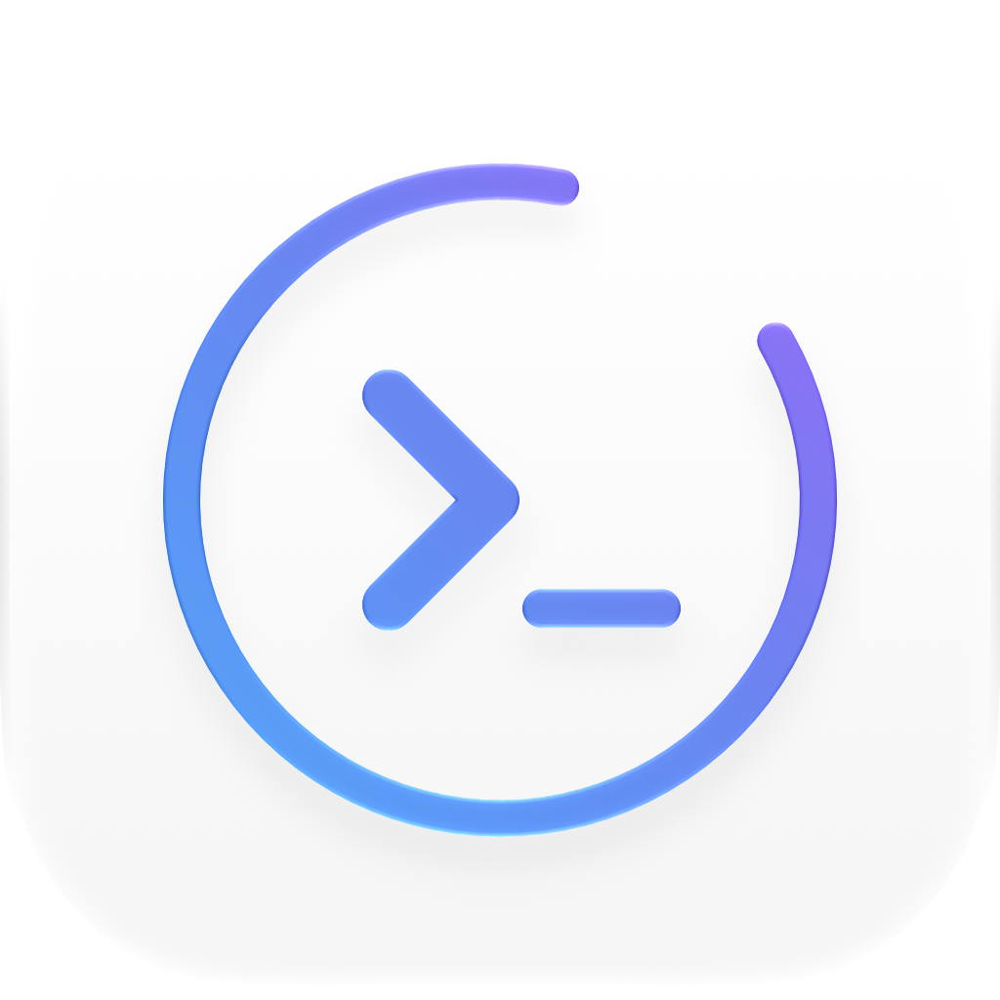

  

<h1 align="center">Loop</h1>

  A native Mac workspace for Claude and Codex.

  <a href="https://loop.lytic.no">Download Loop</a>

---

Loop brings your coding agents, projects, terminals, and Git into one fast Mac
app. It keeps working when you close its window, and you can use it on one Mac
from another.

## Install

The latest stable release represented by this distribution commit is v2.4.0.
From v2.4.0 on, Loop is downloaded and updated from [loop.lytic.no](https://loop.lytic.no).

1. Download Loop from [loop.lytic.no](https://loop.lytic.no).
2. Open it and drag Loop to Applications.
3. Open Loop.

## Requirements

- An Apple silicon Mac with macOS 15 or newer.
- At least one agent, installed and signed in:
  - **Claude Code**;
  - **Codex**.

## Updates

Loop downloads updates by itself and installs them when you quit, or when you
choose **Restart**. You can also choose **Loop › Check for Updates…**.

## Support

- [Report an issue](https://github.com/olekristianbe/loop/issues)
- [Discussions](https://github.com/olekristianbe/loop/discussions)

## License

Copyright 2026 Lytic AS. All rights reserved. Source code is not included in
this distribution.
